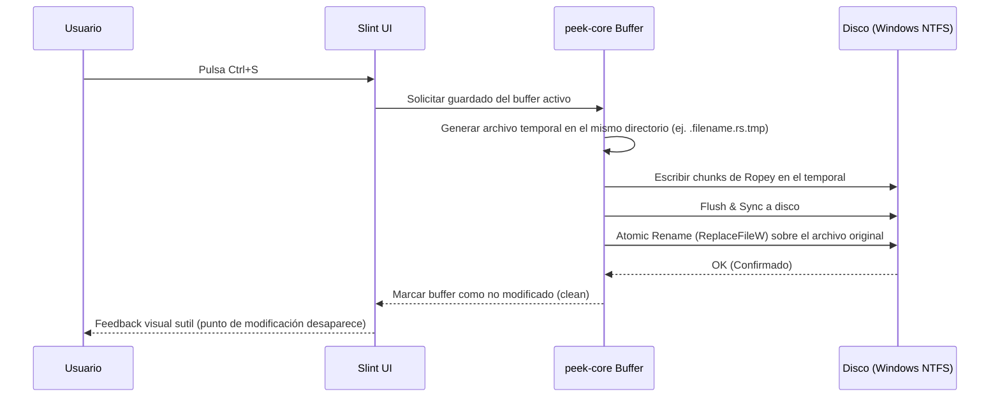

# Arquitectura Técnica de CodePeek (`peek`)

Este documento conserva el diseño aspiracional original. Para el comportamiento implementado y sus límites, consultar [README.md](README.md) y [la auditoría de septiembre de 2026](docs/AUDIT.md). Las cifras de rendimiento de este documento son objetivos sin mediciones verificadas.

La implementación actual usa un controlador en `crates/peek-ui/src/controller.rs` que recibe comandos por canal y realiza I/O, búsqueda y resaltado fuera de la UI. Slint recibe modelos de navegación y el viewport mediante `upgrade_in_event_loop`. El buffer se carga directamente en Rope; no se usa `mmap` para archivos que otro proceso puede truncar. La edición es por línea y el seguimiento externo del archivo activo se hace comprobando metadatos durante la inactividad del trabajador. La configuración JSON separa biblioteca, inicio y último proyecto.

---

## 1. Topología del Workspace de Rust

El proyecto se estructura como un **Cargo Workspace** modular:

```
code-peek/
├── Cargo.toml                    # Configuración raíz del workspace y dependencias compartidas
├── AGENTS.md                     # Directrices para agentes de IA
├── README.md                     # Visión general y benchmarks
├── ARCHITECTURE.md               # Este documento
├── ROADMAP.md                    # Hitos de desarrollo
│
├── crates/
│   ├── peek-core/                # Modelo de datos, buffers con Ropey, gestión de workspace
│   │   ├── src/
│   │   │   ├── buffer.rs         # Envoltorio sobre Ropey (Rope, cursor, selecciones, undo/redo)
│   │   │   ├── workspace.rs      # Estado del directorio abierto, pestañas activas, configuración
│   │   │   └── lib.rs
│   │
│   ├── peek-tree/                # Explorador de archivos multihilo y buscador difuso
│   │   ├── src/
│   │   │   ├── walker.rs         # Recorrido con crate 'ignore' (filtrado .gitignore)
│   │   │   ├── indexer.rs        # Caché ligera en RAM de rutas relativas
│   │   │   ├── fuzzy.rs          # Motor nucleo/fuzzy matcher multihilo
│   │   │   └── lib.rs
│   │
│   ├── peek-syntax/              # Motor de resaltado sintáctico virtualizado
│   │   ├── src/
│   │   │   ├── theme.rs          # Paletas Fluent Dark / One Dark / Tokyo Night
│   │   │   ├── highlighter.rs    # Tokenizado por rango de líneas con Syntect/Tree-sitter
│   │   │   └── lib.rs
│   │
│   ├── peek-ui/                  # Definición de interfaz gráfica nativa (Slint)
│   │   ├── ui/
│   │   │   ├── app.slint         # Ventana principal, split-pane árbol + código
│   │   │   ├── file_tree.slint   # Componente del árbol de carpetas
│   │   │   ├── code_view.slint   # Viewport virtualizado con números de línea
│   │   │   └── fuzzy_modal.slint # Diálogo emergente tipo Ctrl+P
│   │   └── src/
│   │       └── lib.rs
│   │
│   └── peek-app/                 # Binario principal ejecutable (peek.exe)
│       └── src/
│           ├── cli.rs            # Parsing de argumentos ('peek .', 'peek file.rs')
│           ├── main.rs           # Inicialización de hilos, event-loop y arranque
│           └── windows.rs        # Atributos DWM, asociación de extensiones y atajos
```

---

## 2. Principios de Rendimiento y Memoria

### A. Estructura de Texto: `Ropey` en vez de `String`
* **Por qué:** Un `String` contiguo en Rust requiere realocaciones masivas cuando se edita un archivo grande. Si el usuario abre un log de 50 MB, insertar un carácter al principio requiere mover 50.000.000 de bytes en memoria ($O(N)$).
* **Solución:** `Ropey` utiliza un árbol B de fragmentos de texto (chunks de ~512 a 1024 bytes). Cualquier inserción, borrado, salto de línea o división se ejecuta en **tiempo $O(\log N)$**.
* **Líneas y Desplazamientos:** `Ropey` calcula el índice de cualquier línea (`rope.line_to_char(line_idx)`) de forma instantánea gracias a los metadatos almacenados en los nodos del árbol B.

### B. Viewport Virtualizado Estricto
* Si un archivo tiene 200.000 líneas, la pantalla del monitor (ej. 1440p o 4K) solo puede mostrar aproximadamente **45 a 65 líneas a la vez**.
* El componente `code_view` en Slint solo recibe e instancia **el bloque visible en pantalla** más un pequeño margen de precarga (buffer de 10 líneas arriba y abajo).
* Al hacer scroll, la UI actualiza el puntero de línea inicial (`first_visible_line`) y consulta al hilo de sintaxis únicamente por ese rango de líneas.

### C. Resaltado de Sintaxis Virtualizado con `syntect`
* El parsing de sintaxis con `syntect` guarda el estado del parser al final de cada línea (un `ParseState` ligero de unos pocos bytes).
* Al abrir un archivo, un hilo secundario procesa el archivo de fondo sin bloquear la interfaz.
* La pantalla inmediata (líneas 1 a 60) se procesa en el milisegundo 0 para que el usuario vea el código coloreado instantáneamente al abrir la ventana.

### D. Explorador de Archivos con `ignore` (ripgrep)
* El crate `ignore` ejecuta un recorrido recursivo multihilo nativo utilizando las APIs del kernel de Windows (`FindFirstFileExW`).
* Respeta reglas de `.gitignore`, `.ignore` y omite automáticamente carpetas binarias y de dependencias (`.git`, `node_modules`, `target`, `dist`, `.next`).
* En un proyecto grande de 100.000 archivos, el árbol completo se indexa en memoria en **~25 ms** consumiendo menos de 4 MB de RAM.

### E. Buscador Difuso (*Fuzzy Finder* `Ctrl+P`) con `nucleo`
* `nucleo` (creado originalmente para el editor Helix) aprovecha instrucciones vectoriales SIMD (AVX2/NEON) para evaluar miles de rutas por microsegundo.
* Mientras el usuario teclea `srcmain`, el ordenamiento de resultados y resaltado de coincidencias se realiza en tiempo real a 60+ FPS sin demoras de entrada (*zero input lag*).

---

## 3. Flujo de Guardado Atómico (Surgical Micro-Edits)

Cuando el usuario realiza una modificación rápida (ej. corregir una variable o una URL) y presiona `Ctrl+S`:



**Ventaja:** Si se corta la energía o falla el proceso a mitad del guardado, el archivo original **nunca se corrompe**.

---

## 4. Integración con Windows 11

1. **Atributos DWM Fluent:**
   * Uso de `DwmSetWindowAttribute` con `DWMWA_USE_IMMERSIVE_DARK_MODE` (19) para que el marco respete el modo oscuro del sistema.
   * Fondo translúcido opcional mediante `DWMWA_SYSTEMBACKDROP_TYPE` (*Mica* o *Acrylic*).
2. **Asociación en Menú Contextual:**
   * Registro en `HKCU\Software\Classes\Directory\shell\CodePeek` y `Directory\Background\shell\CodePeek` para que al hacer clic derecho en cualquier carpeta aparezca:  
     *⚡ Abrir con CodePeek*
3. **CLI Ergonomics:**
   * Un comando único: `peek [ruta]` (ej. `peek .`, `peek src/lib.rs`, `peek Cargo.toml`).
